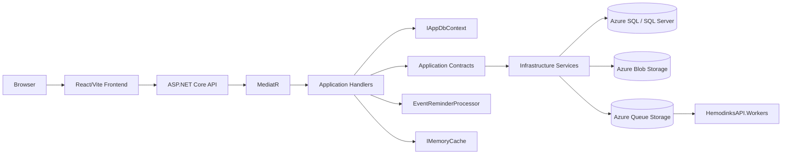
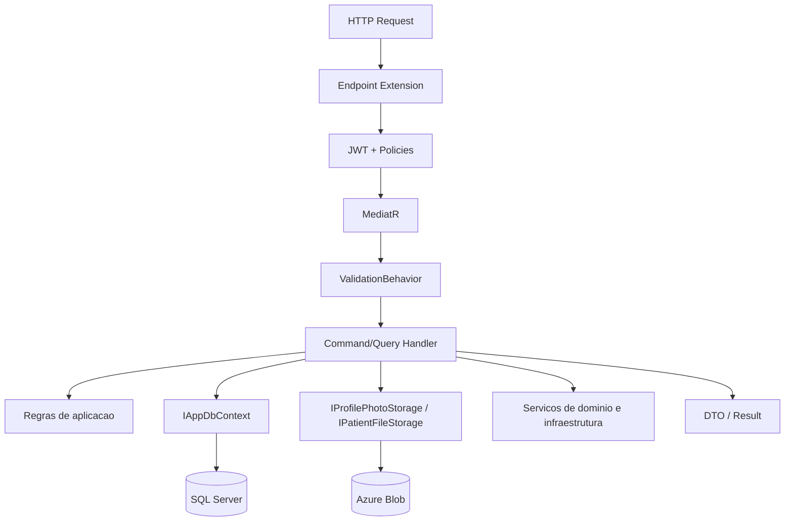
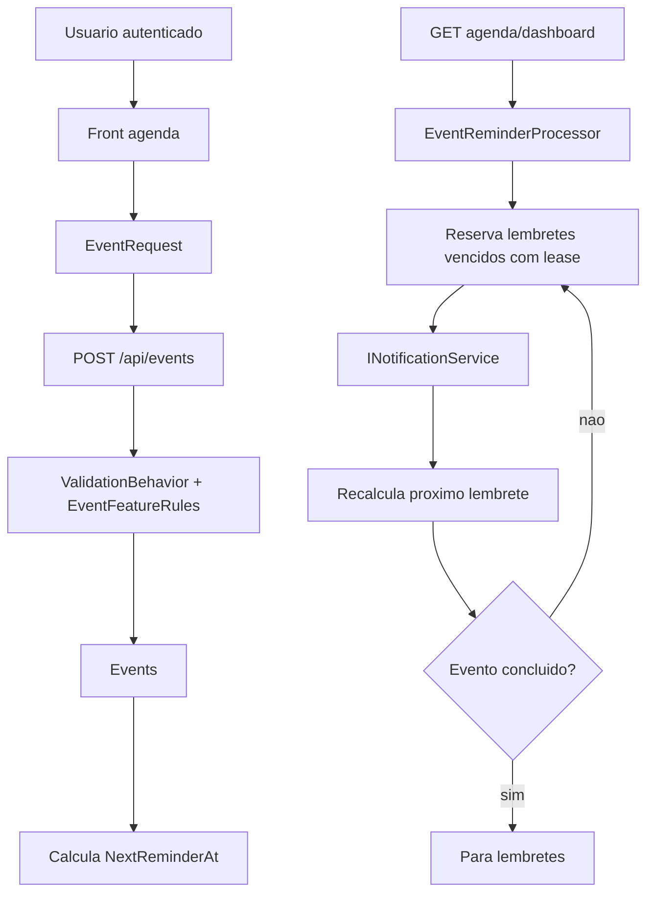
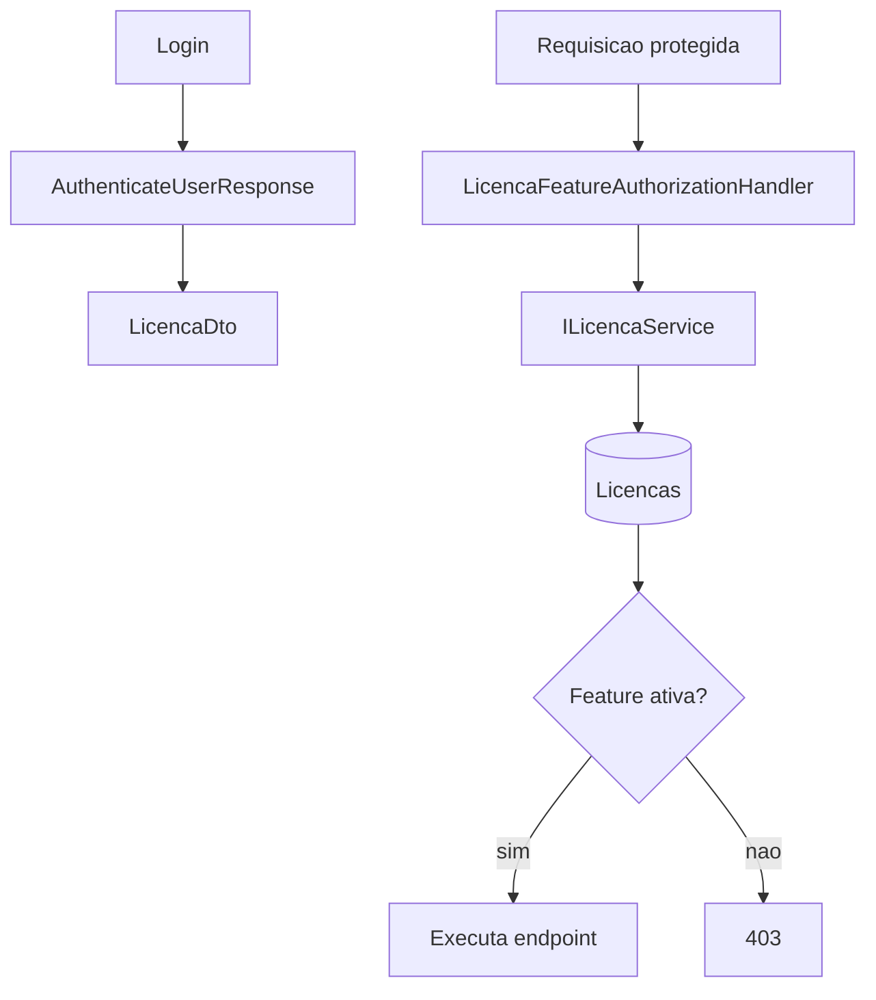
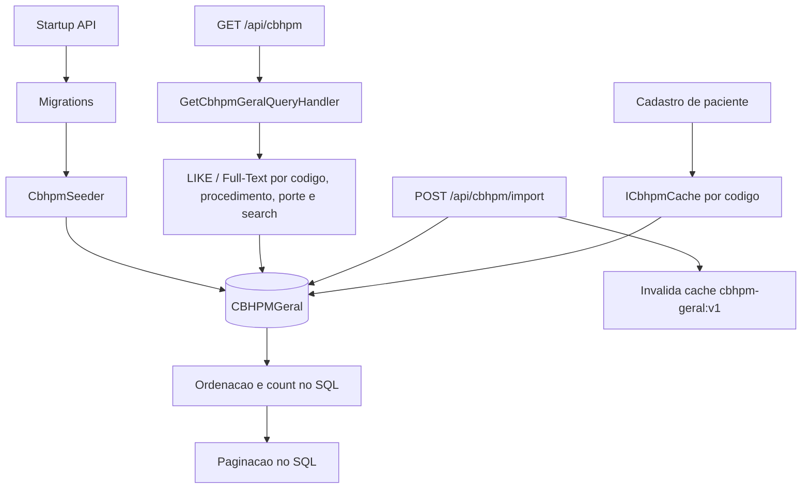

# Hemodinks - Documentacao Tecnica

## Visao geral

O Hemodinks e um SaaS multiclinica: frontend React 19/Vite/TypeScript, API ASP.NET Core/.NET 10, SQL Server/Azure SQL, Azure Blob Storage e Azure Queue Storage + Functions (`HemodinksAPI.Workers`). A API segue Clean Architecture pragmatica com CQRS, MediatR, validacao em pipeline (FluentValidation), EF Core, Minimal APIs, JWT com refresh em cookie `HttpOnly`, isolamento por `ClinicaId` e politicas por perfil/licenca/modulo. Producao roda no Azure Container Apps (blue/green); homologacao, no Render.

URLs principais:

| Recurso | URL |
| --- | --- |
| Frontend local | `http://localhost:5173` |
| Frontend producao | `https://hemodinks.gestao-saude.tec.br` |
| Frontend producao legado | `https://hemodinks-saude.vercel.app` |
| Frontend homologacao principal | `https://hemodinks-homologacao.gestao-saude.tec.br` |
| Frontend homologacao legado | `https://hemodinks-homologacao.vercel.app` |
| Frontend confirmation Render opcional | `https://hemodinks-front-confirmation.onrender.com` |
| API local | `http://localhost:5000` |
| API homologacao | `https://hemodinks-api-1-90nb.onrender.com` |
| API producao | Azure Container Apps `hemodinks-api-prod` (URL em `VITE_API_URL` do front) |
| Swagger local | `/swagger` |
| Scalar local | `/scalar` |
| OpenAPI JSON local | `/openapi/v1.json` |

Em ambiente publicado, as rotas de documentacao interativa exigem `ApiDocumentation__Enabled=true`.

## Projetos e responsabilidades

| Projeto | Responsabilidade |
| --- | --- |
| `HemodinksAPI.Domain` | entidades, constantes e utilitarios puros |
| `HemodinksAPI.Application` | commands, queries, handlers, DTOs, validadores, contratos e regras |
| `HemodinksAPI.Infrastructure` | EF Core, migrations, seeders, JWT, storage, notificacoes, filas e implementacoes concretas |
| `HemodinksAPI.Api` | Minimal APIs, auth, CORS, Swagger/Scalar e composition root |
| `HemodinksAPI.Workers` | Azure Functions: `GenerateFileExport`, `SendPasswordResetEmail(Sync)`, `SendEventEmail`, `UploadPatientFile`, `UploadProfilePhoto` |
| `HemodinksAPI.Tests` | xUnit v3: unitarios, integracao (InMemory/SQLite) e `*SqlServerTests` |
| `Hemodinks.AppHost` / `Hemodinks.ServiceDefaults` | orquestracao local com .NET Aspire (API + front) |
| `tools/Hemodinks.SchemaGuard` | verifica o historico de migrations antes de deploys |

## Componentes



## Modulos funcionais

### Multiclinica e plataforma

- `Clinica` com plano (`Trial`, `Completa`, `Parcial`), modulos liberados e assinatura
- `UsuarioGlobal` (credencial unica) e `UsuarioClinica` (perfil por clinica)
- `ClinicaId` do JWT e o tenant efetivo; filtro global do EF falha fechado e bloqueia FK entre clinicas
- `ClinicaModuleAccessMiddleware`: no plano `Parcial`, modulos nao contratados retornam 403 (Administrador e SuperAdministrador nao sao bloqueados)
- SuperAdministrador cria, desativa e alterna clinicas (`/api/session/selecionar-clinica`); Administrador ve e atualiza a propria
- seletor publico de clinicas no login (`/api/public/clinicas`) e auditoria da plataforma

### Usuarios e autenticacao

- login JWT (`/api/users/login-context` + `/api/users/authenticate`)
- refresh token rotativo em cookie `HttpOnly`, com expiracao deslizante apos 30 minutos de inatividade
- renovacao de JWT, registro de atividade e revogacao de sessao no logout
- reset de senha por email/token
- reset administrativo com senha temporaria aleatoria e troca obrigatoria (`/api/users/password/temporary/complete`)
- troca de e-mail com confirmacao
- hash PBKDF2-SHA256 com 600 mil iteracoes e rate limiting de autenticacao
- foto de perfil
- anexos do cadastro medico

### Equipes

- identidade coletiva (perfil `Equipe`) com membros e operadores
- identificacao do operador por selecao ou PIN (`/api/equipe-auth/identificar`, `/api/equipe-auth/pin`)
- operacoes sensiveis exigem operador identificado (`EquipeOperacaoSensivel`) e sao auditadas

### Pacientes, cirurgias e observacoes

- cadastro clinico/administrativo da cirurgia
- `TipoCirurgia` (`Eletiva`, `Urgencia`, `EmAutorizacao`) e `StatusCirurgia` (`Consolidada` quando a data da consolidacao esta preenchida; `NaoConsolidada` caso contrario), ambos filtraveis nas listagens e exportacoes
- procedimentos CBHPM
- anexos
- observacoes com resposta e leitura
- vinculo com usuario do perfil Paciente

### Dashboard

- resumo operacional
- notificacoes da agenda
- observacoes nao lidas
- indicadores condicionados por licenca

### Agenda e notificacoes

- CRUD de eventos
- destinatarios permitidos por usuario/grupo
- notificacao para usuario, perfil medico e grupos medicos
- lembretes com `NextReminderAt`

### Faturamento medico

- leitura agregada do faturamento (`/api/faturamentos-medicos`)
- escopo por perfil, filtros por tipo e status da cirurgia
- totais, glosas, convenios e checklist
- historico mensal de arquivos

### Financeiro

- atendimentos cirurgicos com procedimentos e anexos
- faturamentos com itens, status, glosas, recursos de glosa e retorno do convenio
- contas a receber, recebimentos, comprovantes, estornos e cancelamentos
- precos por convenio e procedimento CBHPM
- resumo financeiro, auditoria financeira e resumo financeiro do paciente

### Grupos medicos

- CRUD de grupos
- membros medicos por escopo
- apoio a notificacoes da agenda

### Configuracao do sistema

- nome e foto institucionais (pertencem a `Clinica`; alterados pelo SuperAdministrador)
- endpoints publicos somente leitura para login e branding do front

### Licencas

- trial
- plano completo
- liberacao de features por medico

### CBHPM

- consulta paginada
- importacao administrativa
- cache em memoria

### Exportacoes assincronas

- endpoint `POST /api/exports` (`pacientes`, `faturamentos-medicos`, `cbhpm`)
- a API monta o snapshot no servidor com as mesmas queries e escopo do perfil (`FileExportSnapshotBuilder`)
- a fila `FileExportQueueName` entrega o snapshot a `GenerateFileExport` no `HemodinksAPI.Workers`
- as telas do front tambem exportam no navegador os dados ja filtrados pela API

### LGPD e monitoramento

- aceites legais (`/api/legal-acceptances/current`) e preferencias de privacidade (`/api/privacy-preferences/current`)
- erros tecnicos e eventos de seguranca em `/api/monitoramento/*` (Administrador: propria clinica; SuperAdministrador: todas)

## Perfis e escopo

| Id | Perfil | Escopo principal |
| --- | --- | --- |
| 1 | Administrador | gestao da clinica; propria clinica e equipes na plataforma |
| 2 | Medicos | agenda, pacientes, atendimentos e faturamento no escopo, meu cadastro |
| 3 | Pacientes | proprio cadastro quando vinculado |
| 4 | Controller | pacientes, faturamento medico, financeiro e grupos medicos |
| 5 | SuperAdministrador | plataforma: clinicas, auditoria e troca de clinica |
| 6 | Equipe | identidade coletiva com operador identificado |

A matriz completa esta em [MATRIZ_PERFIS_PERMISSOES.md](MATRIZ_PERFIS_PERMISSOES.md).

Features de licenca atuais:

- `Dashboard.Visualizar`
- `Pacientes.Visualizar`
- `Pacientes.Gerenciar`
- `Cbhpm.Consultar`

## Fluxos principais

### Fluxo HTTP e CQRS



### Fluxo de agenda e notificacoes



### Fluxo de observacoes do paciente

```mermaid
flowchart TD
    Screen[Modal de observacoes] --> List[GET /api/pacientes/{id}/observacoes]
    Screen --> Create[POST /api/pacientes/{id}/observacoes]
    List --> Read[POST /api/pacientes/{id}/observacoes/marcar-lidas]
    Create --> Rules[PacienteObservacaoRecipients]
    Rules --> Db[(Observacoes)]
```

### Fluxo de licencas



### Fluxo de CBHPM



## Persistencia

Tabelas principais (DbSets de `AppDbContext`):

- Multiclinica e identidade: `Clinicas`, `UsuariosGlobais`, `UsuariosClinicas`, `Users`, `Perfis`, `AuthenticationSessions`, `TemporaryAccessCredentials`, `EmailChangeRequests`, `PasswordResetTokens`, `AuditoriasPlataforma`
- Equipes: `Equipes`, `EquipeMembros`, `EquipeOperadores`, `EquipeLoginDesafios`
- LGPD: `UserLegalAcceptances`, `UserPrivacyPreferences`
- Pacientes: `Pacientes`, `PacienteArquivos`, `PacienteProcedimentos`, `Observacoes`
- Faturamento medico: `FaturamentosMedicos`, `FaturamentoHistoricoArquivos`
- Financeiro: `AtendimentosCirurgicos`, `AtendimentoProcedimentos`, `AtendimentoArquivos`, `Faturamentos`, `FaturamentoItens`, `Glosas`, `RecursosGlosa`, `ContasReceber`, `Recebimentos`, `ConvenioProcedimentoPrecos`, `FinanceiroMigracaoInconsistencias`
- Agenda: `Events`, `AgendaNotifications`, `EventEmailDeliveries`
- Catalogos e grupos: `Hospitais`, `Convenios`, `OPME`, `CbhpmGeral`, `GruposMedicos`, `GrupoMedicoUsuarios`
- Outros: `UserArquivos`, `Licencas`, `ConfiguracoesSistema`, `IdempotencyRequests`

O schema e configurado em `HemodinksAPI.Infrastructure/Data/Configurations`.
Migrations ficam em `HemodinksAPI.Infrastructure/Data/Migrations` e podem ser validadas com:

```powershell
dotnet tool restore
pwsh ./scripts/Test-Migrations.ps1
dotnet tool run dotnet-ef migrations list --project HemodinksAPI.Infrastructure --startup-project HemodinksAPI.Api --no-connect
```

## Recursos externos

| Recurso | Status | Uso |
| --- | --- | --- |
| Azure SQL Database | usado | banco relacional da aplicacao |
| Azure Blob Storage | usado | fotos, anexos e arquivos exportados |
| Azure Queue Storage | usado | reset por email e jobs de exportacao |
| Azure Functions | usado | projeto `HemodinksAPI.Workers` (container ou Function App) |
| Azure Container Apps | usado | producao: API blue/green e workers |
| Render | usado | homologacao (`hemodinks-api-1`) |
| GitHub Container Registry | usado | imagens `hemodinks-api` e `hemodinks-api-workers` |
| New Relic APM | usado | telemetria da API (Browser no front) |

## Documentacao interativa

Swagger e Scalar sao servidos pela propria API:

- Swagger UI: `/swagger`
- Scalar UI: `/scalar`
- OpenAPI JSON: `/openapi/v1.json`
- Swagger JSON: `/swagger/v1/swagger.json`

Tags atuais do documento OpenAPI: `Sessao`, `Users`, `Equipes`, `Equipes - Autenticacao`, `Plataforma - Clinicas`,
`Plataforma - Auditoria`, `Clinicas - Publico`, `ConfiguracoesSistema`, `Legal`, `Privacy`, `Dashboard`, `Pacientes`,
`Atendimentos cirurgicos`, `Faturamento medico`, `Faturamento`, `Contas a receber`, `Relatorios financeiros`,
`Precos por convenio`, `GruposMedicos`, `Agenda e notificacoes`, `CBHPM`, `Hospitais`, `Convenios`, `OPME`,
`Licencas`, `Exports` e `Monitoramento`.

O inventario completo de rotas com o acesso por perfil esta no [README](../README.md#endpoints-principais).

## Observacoes operacionais

- `IMemoryCache` de CBHPM e local por instancia
- lembretes: `EventNotificationHostedService` roda em desenvolvimento/compose; em producao `EventReminders__RunHostedProcessor=false` e `EventReminderProcessor` reserva os vencidos durante consultas de agenda e dashboard
- emails de eventos: `EventEmailDeliveryHostedService` (polling apos requisicoes autenticadas) ou Function `SendEventEmail`
- configuracao do sistema e publicas de clinica sao anonimas para permitir branding no login do front
- exportacoes e reset por email saem da API para filas/Functions sem mover auth e regras de negocio
